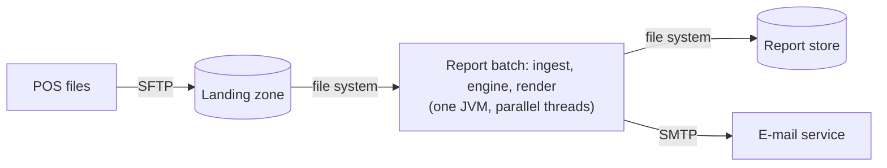
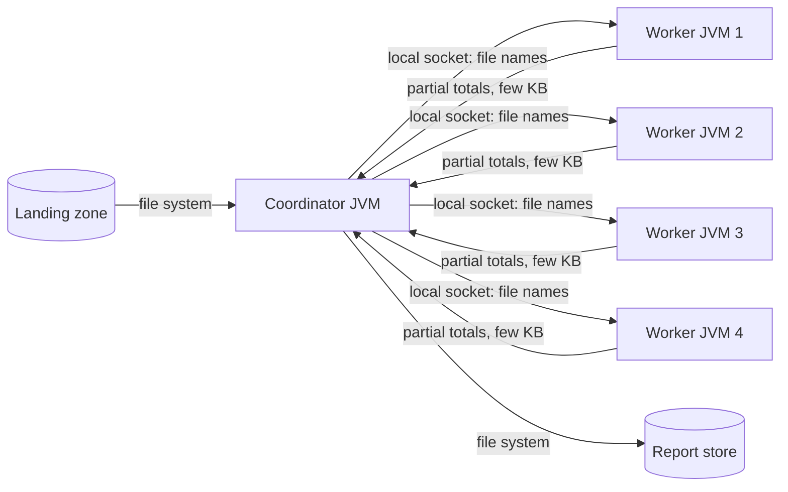
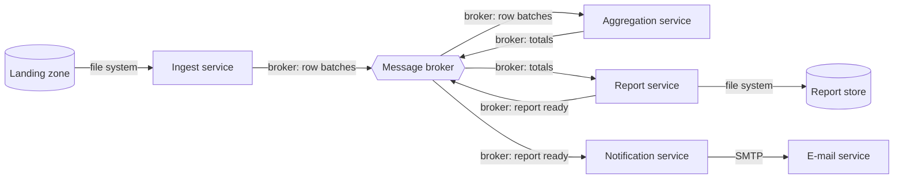

# ATAM-style evaluation: release 1 architecture

## Business drivers
- The report for month M must be ready on the morning of day 2 of M+1 (brief); the finance director decides on it.
- Branch links fail now and then; a wrong or silently incomplete total is worse than a late one (brief, QA-3).
- Branch managers see their own branch only (brief, QA-5).
- Small team, eight weeks, Java skills, no operations staff at the client (constraints of ADR-0001).
- The chain may open more branches and wants the report earlier (the question asked by head office).

## Candidates

### A: modular monolith batch (one JVM)

### B: process pipeline

### C: event-driven microservices

## Scenario analysis
Rating: ++ very good, + good, 0 neutral, − poor.

| Scenario | A modular monolith | B process pipeline | C event-driven microservices |
|----------|--------------------|--------------------|------------------------------|
| QA-1 performance (3 M rows, 60 s) | ++ no serialization or hop; about 4.9 s | + only small partial totals cross processes; about 7.3 s, plus JVM start-up | − per-row events need 60 s of broker time; fine only with batching (about 5.4 s) |
| QA-2 scalability (6 branches, 120 s) | 0 vertical only: more cores and a faster disk, one host | + workers can be added, later on more hosts | ++ every service scales alone and the broker spreads the load |
| QA-3 availability (late BTB file) | + files stay in the landing zone; re-run is cheap and idempotent | + a crashing worker is restarted by the coordinator, but the coordinator is a single point of failure | ++ the broker buffers and services restart independently, but the broker itself is a new failure point |
| QA-4 modifiability (new format) | + new renderer behind a sealed interface in the same repository, about 4 files | 0 renderer lives in the coordinator; same effort as A plus a check of the message contract | 0 a format means a change in the report service and possibly the message contract, plus a deployment |
| QA-5 security (one branch per manager) | ++ one deployable, one perimeter (the web page) | + a few local sockets must be protected on the host | − more endpoints: broker credentials, service-to-service authentication, more places to forget a check |
| QA-6 testability (engine tests, 30 s) | ++ plain JUnit tests, no processes, no network | 0 needs tests that start processes and check sockets | − needs a broker or containers for integration tests; slower suites |
| Cost and skills | ++ one Maven project, skills we have, one deployable | 0 process management and a protocol to design | − a broker to operate, deployment tooling, more than eight weeks of learning |

## QA-1 estimates (assumptions first)
Assumptions: 3.0 M rows; parse and validate one row with BigDecimal 5 microseconds on one core, so 3.0 M x 5 us = **15 s** of parallelisable work; merging partial totals 2 s and rendering 1 s are serial; 8 cores; one JVM starts in 0.5 s; message serialization plus deserialization 1 us per row, parallelisable; broker throughput 50 000 messages per second; an event carries one row (variant 1) or 1 000 rows (variant 2); partial totals of a worker are a few KB (negligible to send).

- **A** (one JVM, 8 parser threads): 15 / 8 + 2 + 1 = 1.875 + 3 = **4.9 s** (meets 60 s, margin about 12x).
  Amdahl's law: parallel fraction p = 15 / 18 = 0.83, N = 8: S = 1 / ((1 - p) + p / N) = 1 / (0.17 + 0.104) = 3.7, and 18 s / 3.7 = 4.9 s (consistent).
- **B** (4 worker JVMs, JVM start-up in parallel, partial totals sent back): 0.5 + 15 / 4 + 2 + 1 = 0.5 + 3.75 + 3 = **7.3 s** (meets).
  Amdahl for N = 4: S = 1 / (0.167 + 0.833 / 4) = 1 / (0.167 + 0.208) = 2.67, and 18 s / 2.67 = 6.75 s plus 0.5 s start-up = 7.25 s, which rounds to 7.3 s (consistent).
- **C, variant 1** (one row per event): broker time alone 3.0 M / 50 000 = **60 s**; parsing overlaps, but the serial 3 s comes after, so the end-to-end time is about 63 s and the scenario **fails** (budget 60 s).
- **C, variant 2** (1 000 rows per event): 3 000 events / 50 000 = 0.06 s of broker time; serialization 3.0 M x 1 us = 3 s, spread over 8 cores = 0.38 s; so 15 / 8 + 0.38 + 0.06 + 2 + 1 = 1.875 + 3.44 = **5.3 s** (meets), and one extra network hop of about 0.1 s makes it **5.4 s**.

All three meet QA-1 if C is batched; only A does so without any tuning.

## Sensitivity points
- **S1:** the number of parser threads or workers (N) affects QA-1 in A and B: from N = 1 to N = 8, A goes from 18 s to 4.9 s; beyond 8 cores the serial 3 s dominates (Amdahl).
- **S2:** the per-row parse cost (5 us assumed) affects QA-1 in all candidates; switching money from BigDecimal to cents as `long` would cut the 15 s sharply but breaks the money rule of the brief, so we keep BigDecimal and measure in Lab-02.
- **S3:** the event batch size in C affects QA-1 by three orders of magnitude (60 s versus 0.06 s of broker time) and QA-3 slightly (a larger batch means a bigger replay after a failure).
- **S4:** the grace period before the partial report (90 min) affects QA-3 in every candidate: a longer wait gives a complete report more often but risks missing the morning.

## Trade-off points
- **T1:** a broker between ingest and aggregation (C) buffers late files and lets services scale (+QA-3, +QA-2) but adds a network hop, serialization and an operated component (-QA-1, -cost, -QA-5 because the attack surface grows).
- **T2:** splitting work into processes (B) isolates failures and allows more hosts (+QA-3, +QA-2) but costs start-up time, a protocol and harder tests (-QA-1 a little, -QA-6, -cost).
- **T3:** the grace period before a partial report (S4) trades completeness of the first report against its timeliness (QA-3 completeness versus QA-1 deadline).

## Risks, non-risks, risk themes
Risks:
- **R1:** C with one row per event misses QA-1 by a few seconds and is easy to build by accident.
- **R2:** nobody on the team has operated a message broker; a failure at 06:00 would have no experienced owner.
- **R3:** A keeps everything in one heap; if aggregation keeps all rows (about 750 MB) a small server could run out of memory.
- **R4:** the single server of A (and the coordinator of B) is a single point of failure on the critical morning.

Non-risks:
- **N1:** BigDecimal totals can be checked against a sequential baseline, so parallel summation does not change the money.
- **N2:** A meets QA-1 with a margin of about 12x (4.9 s against 60 s), so a slower disk or parse cost does not threaten the deadline.
- **N3:** a new renderer behind the sealed interface is a small, local change (QA-4) in every candidate.

Risk themes:
- **RT1, throughput and deadline** (R1, R3): the morning deadline of day 2 depends on how rows move and where they are held; linked to the business driver "report on the morning of day 2". Mitigation: stream the aggregation, measure QA-1 in Lab-02 with 3 M generated rows.
- **RT2, operations and single points of failure** (R2, R4): a client without operations staff cannot recover from a broker or server failure at 06:00; linked to the drivers "wrong or incomplete totals are worse than late" and "small team, eight weeks". Mitigation: keep release 1 simple (A), keep files as the shared state, write a runbook for a manual re-run.

## Recommendation
**Confirm ADR-0001** (candidate A, modular monolith batch). It meets QA-1 with a margin of about 12x, is the best candidate for QA-5, QA-6 and cost, and handles QA-3 through the landing zone and the idempotent re-run of ADR-0002; it is weaker only for QA-2 (scalability) and for the single point of failure (R4), which the table shows as 0 and +. Because QA-2 is ranked (M,M) and the margin is large, we accept this. We keep the "Revisit when" trigger of ADR-0001 (a month above 10 M rows, a run above 30 s, or more than 8 branches); if that happens, candidate B is the next step (reuse the parsing code, add worker processes), not C. No ADR-0003 is needed now.
