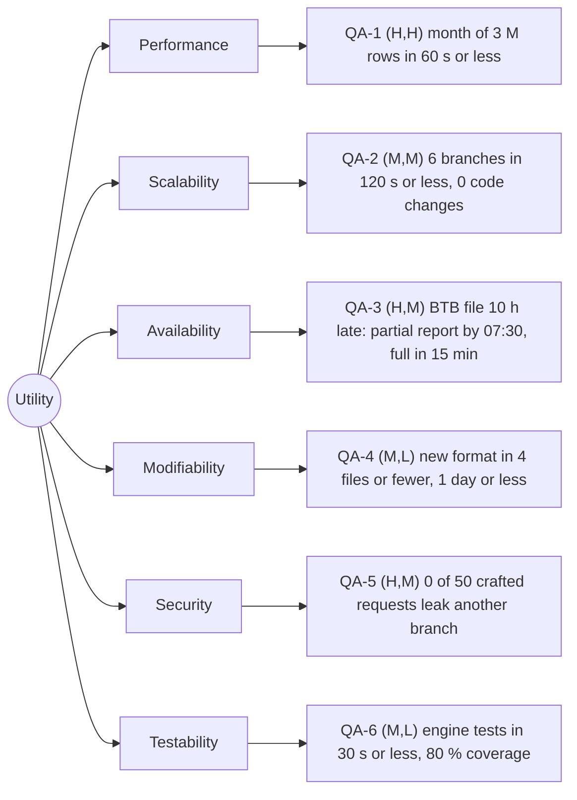

# Quality-attribute scenarios: Angkor Mart monthly sales report

## Stakeholders
- Head-office analyst: opens, filters and exports the monthly reports (PDF, Excel); wants the numbers early and correct.
- Branch manager (PNH, REP, BTB): reads the web page of **their own branch only**; must never see another branch.
- Finance director: receives an e-mail when the report is ready; decides on the numbers, so a wrong or partial report must be recognisable as such.
- Operations person who runs the job: starts, monitors and re-runs the batch; needs clear failure messages and safe re-runs.
- Development team (us): adds formats and branches, writes tests, keeps the build green.

## Scenarios

| ID | Attribute | Source | Stimulus | Artifact | Environment | Response | Response measure | Rank |
|----|-----------|--------|----------|----------|-------------|----------|------------------|------|
| QA-1 | Performance | Scheduler, 06:00 on day 2 of M+1 | Starts the report for a month of about 3 M rows | Report engine | Normal operation, 8-core server, all files complete | Report files written, "ready" event published | <= 60 s wall-clock, median of 5 runs after 2 warm-up runs | (H,H) |
| QA-2 | Scalability | Head office management | Chain grows from 3 to 6 branches (about 6 M rows per month) | Ingest job and report engine | Normal operation, same 8-core server, files complete | Report is produced without code changes; only the branch list in the configuration is extended | <= 120 s wall-clock (at most 2.0 x the QA-1 time), median of 5 runs after 2 warm-up runs; 0 source files changed | (M,M) |
| QA-3 | Availability | Branch internet link (BTB) | The file of the last day of the month arrives at 10:00 on day 2 instead of 23:00 the day before | Ingest job, landing zone, report batch | Operation with a failed link; the other 2 branches delivered on time | At 06:00 + 90 min grace the batch publishes a **partial** report marked "BTB missing"; when the late file arrives the full report is rebuilt and the finance director is notified | Partial report published by 07:30 in 5 of 5 fault-injection runs (BTB file withheld); full report <= 15 min after the late file lands (timestamps in the run log); 0 duplicated rows after the re-run (row count equals the sequential baseline) | (H,M) |
| QA-4 | Modifiability | Developer | Client asks for a new output format (for example JSON) | Report renderers (render package) | Development time, existing tests green | New renderer added behind the ReportRenderer interface; no change in model, ingest or engine | <= 4 files touched (1 new renderer, the sealed interface and factory, 1 test), 0 files in model/ingest, <= 1 person-day; measured with `git diff --stat` | (M,L) |
| QA-5 | Security | Branch manager of REP | Requests the report of another branch (changes the branch code in the URL, guesses file names) | Web report page and report store | Normal operation, user logged in as manager of REP | Request is refused and logged; the manager sees REP data only | 0 of 50 crafted requests (other branch, other month, path traversal) return data of PNH or BTB; all 50 answered with HTTP 403 or 404; 1 audit-log entry per refused request within 1 s; measured with an automated authorisation test suite | (H,M) |
| QA-6 | Testability | Developer or CI server | Runs the engine tests after each commit | Report engine and model | CI machine without network, without the real data folder | Tests run without UI, network or the production files | Engine suite <= 30 s wall-clock; >= 80 % line coverage of engine and model (JaCoCo report); 0 tests that read outside a `@TempDir` | (M,L) |

## Rank justifications
- QA-1 (H,H): the report is due on the morning of day 2; 3 M rows with BigDecimal arithmetic and a hard deadline force parallel parsing and streaming aggregation, which shapes the whole structure.
- QA-2 (M,M): more branches are plausible but not planned; the cost is moderate if the branch list is configuration and the work per branch is independent.
- QA-3 (H,M): branch links "fail now and then" and the finance director must not receive a silently wrong total; the design needs a landing zone, idempotent loading and a re-run path, which is a real but well-known structure.
- QA-4 (M,L): three formats are wanted now (PDF, Excel, web page) and more may come; one interface with a renderer per format makes each addition small.
- QA-5 (H,M): the brief says managers may see their own branch only, so a leak is a business failure; the difficulty is moderate because the rule must hold at every entry point, not only in the UI.
- QA-6 (M,L): important for a team that works in pairs for 8+ weeks, but cheap to get if the engine has no hidden dependencies on files or UI.

## Assumptions
- A1: the report server has 8 cores and an SSD (to confirm with the client).
- A2: parsing and validating one row with BigDecimal costs about 5 microseconds on one core (to be measured in Lab-02).
- A3: "partial report" is acceptable to head office if it is clearly marked and replaced automatically (to confirm with the client).
- A4: a grace period of 90 minutes after 06:00 is acceptable; 07:30 is still "morning" for the finance director.
- A5: the web page runs behind a login that gives each manager exactly one branch code.
- A6: a 4th to 6th branch uses the same POS CSV format and the same SFTP upload.
- A7: CI machines have no access to the production data folder.

## Utility tree

## Architectural drivers
QA-1 (H,H), QA-3 (H,M), QA-5 (H,M). These three decide the structure of release 1 (ADR-0001) and the data flow (ADR-0002); QA-2, QA-4 and QA-6 are kept in mind but do not force the shape.
